# Pounce 🐾

**Cats, Cats Effect and Play 3 superpowers for IntelliJ IDEA.** 🌐 [pounce.zakaria.lu](https://pounce.zakaria.lu)

Pounce brings typeclass-aware completion, effect-safety inspections, visual hints and Play 3 wiring to Scala
projects. It aims to feel like IntelliJ's Spring support, but for Typelevel and Play code. It targets
**Scala 2.13 + Play 3** first; Scala 3 user code is supported too.

> **Status: v0.1.0-SNAPSHOT.**
> - Built against IntelliJ IDEA **2026.2** (build 262.\*) and the Scala plugin **2026.2.18**.
> - About 540 automated tests, each running inside a real headless IntelliJ against real cats, cats-effect and Play jars.
> - Partly tried by hand in IntelliJ IDEA 2026.2.1. The rest is still in progress, see [Known limitations](#known-limitations).

<p align="center">
  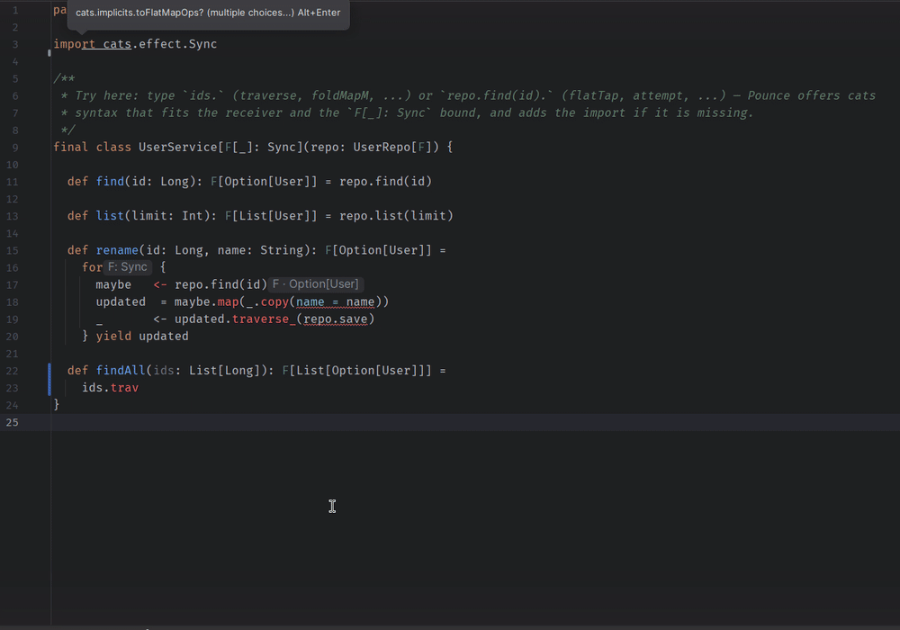
  <br>
  <sub>Type <code>ids.trav</code> in tagless code: only syntax that has instances is offered, and picking it adds the import.</sub>
</p>

---

## What you get

### Completion that understands typeclasses
- **Cats syntax without imports.** Type `ids.` on a `List[Int]` and get `traverse`, `foldMapM`, `traverseFilter`…
  - Only operations whose instances exist for that type are offered, and that includes `F[_]: Monad` bounds in tagless code.
  - Picking one adds the import in your project's style (`cats.syntax.all._`, `cats.implicits._` or granular imports).
  - The popup shows why an item applies, e.g. ` Traverse[List] · cats-core`, and Ctrl+Q explains it. This works
    whether or not the syntax is already imported.
- **Tuples:** `(fa, fb).mapN((a, b) => …)`, `parMapN`, `tupled`, `flatMapN`, with the right arity.
- **Lifts ranked by expected type:** `.asRight[String]`, `.some`, `.pure[F]`, `.raiseError[F, A]`, `.validNel`…
- **Durations without the import:** `5.seconds`, `250.millis`, `10.minutes`, `1.5.hours`, `3L.days`, on `Int`, `Long`
  and `Double` (every unit, plural and singular). Picking one adds `import scala.concurrent.duration._`. They come
  first when a `FiniteDuration` is expected (`IO.sleep(5.<caret>)`, `val timeout: FiniteDuration = 5.<caret>`).
- **Smart completion** (Ctrl+Shift+Space):
  - constructors of the expected type (`IO.pure`, `OptionT.liftF`);
  - `Sync[F].delay(…)` when the bound is in scope;
  - lifts of values in scope (`user.some.pure[IO]`).
- **Curated companions:** `IO.`, `Sync[F].`, `Resource.`, `Ref.` list the useful members first, with docs.
- **Postfix templates:** `.io`, `.delay`, `.blocking`, `.pure`, `.some`, `.asRight`, `.void`, `.attempt`, `.start`,
  `.traverse`, `.liftF`, `.eval`.
- **Quick docs** (Ctrl+Q) on suggestions: signature, constraints, example, and *why it applies here*.
- All of this runs on a curated catalog of 600+ operations from cats-core, cats-data, cats-effect (+ std), fs2 and
  `scala.concurrent.duration`.

### Inspections that catch real effect bugs (28 inspections, most with quick fixes)
| Inspection | Example |
|---|---|
| Discarded effect | `{ IO.println("lost"); IO.unit }`: the first effect never runs |
| Nested effect | `io.map(id => IO(…))` gives `IO[IO[_]]`. Fix: `flatMap` |
| Blocking call in `delay` | `IO(Thread.sleep(100))`. Fix: `IO.blocking` / `interruptible` |
| `unsafeRun*` outside the edge | Play `Action.async { io.unsafeToFuture() }`, `IOApp`, Guice/Play modules and tests are allowed |
| Eager `Future` | `IO.fromFuture(IO.pure(alreadyRunning))` |
| Fiber leak | `fa.start.void`: started and forgotten |
| Resource escapes `use` | `res.use(IO.pure)`: the value is released before you get it |
| Mixed effects in `for` | `IO` and `Option` generators, with lift fixes |
| Tagless bounds | redundant `F[_]: Monad: Sync`; "Strengthen bound to Monad" when `.flatMap` won't resolve; add a missing context bound |
| Conflicting cats imports | `cats.implicits._` + `cats.syntax.all._` |
| 17 simplifications | `map(_ => ())` → `void`, `map(f).sequence` → `traverse(f)`, `if (c) fa else F.unit` → `fa.whenA(c)`, … |

Before a simplification is offered, its replacement is type-checked against your code. If it doesn't resolve, or
doesn't keep the original type, you never see it.

<p align="center">
  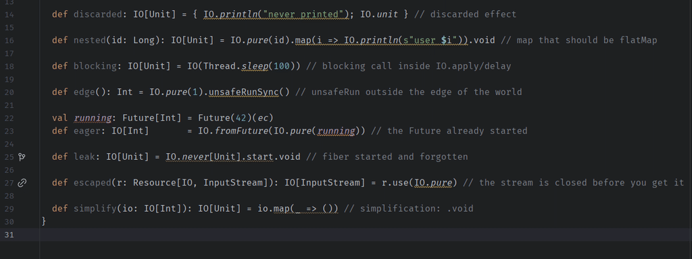 IO.println(...)). Alt+Enter, Replace map with flatMap, fixes it">
  <br>
  <sub>A <code>map</code> that builds an <code>IO[IO[_]]</code>, fixed with one Alt+Enter.</sub>
  <br><br>
  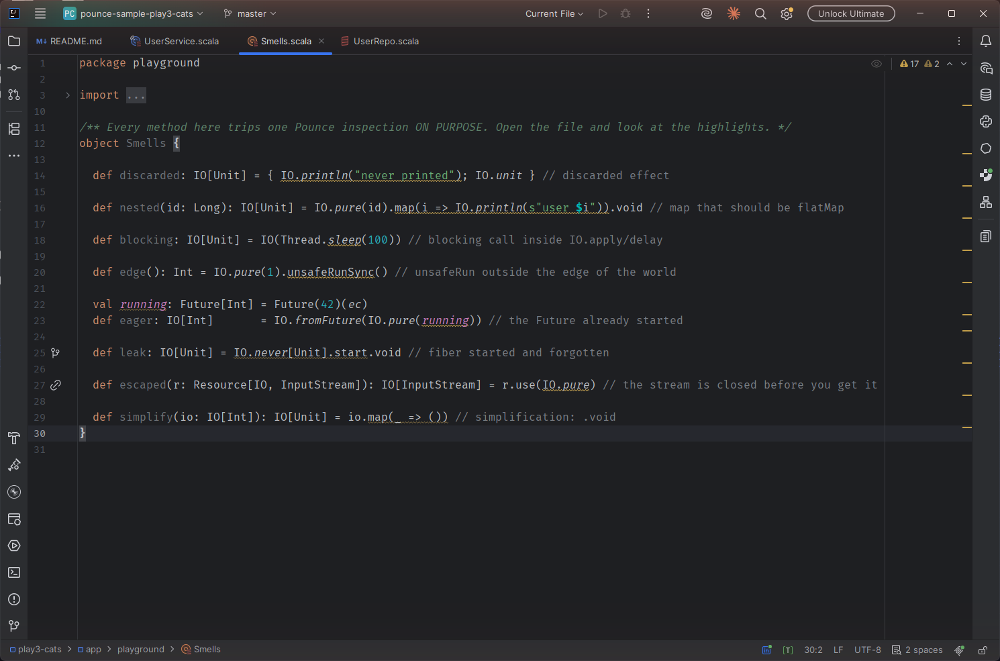
  <br>
  <sub><code>samples/play3-cats/app/playground/Smells.scala</code>: each method trips a different inspection.</sub>
</p>

### See what your effects are doing
- **For-comprehension lens.** Each `<-` gets an `IO · User` hint. The `for` keyword shows the effect and bounds
  (`F: Sync`). A step in the wrong effect is marked `Option · String ≠ IO`.
- **Gutters:** fork points (new fiber), the blocking pool, Resource acquire ↔ release, and tagless wiring
  (`trait UserRepo[F[_]]` ↔ implementations ↔ where they're constructed).
- **Type aliases:** "Introduce type alias `AppIO[A]` for `EitherT[IO, AppError, *]`".
- **Instance hints** (opt-in): `ids.traverse(f)` shows `Traverse[List] · Applicative[IO]`.
- **The Pounce tool window**
  - *Typeclass Explorer:* which instances the type under the caret has, plus what you can call on it.
  - *Combinator Finder:* "I have `List[A]`, I want `IO[List[B]]`". Hoogle-style search over the catalog (Ctrl+Alt+Shift+K), plus a **Fill `???`** intention.
  - *Endpoints:* http4s routes, Play `conf/routes` and tapir endpoints, with navigation.

<p align="center">
  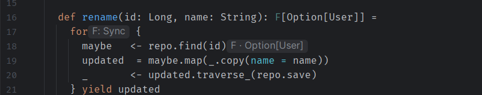
  <br>
  <sub>The lens: <code>F: Sync</code> on the <code>for</code>, <code>F · Option[User]</code> on the step.</sub>
  <br><br>
  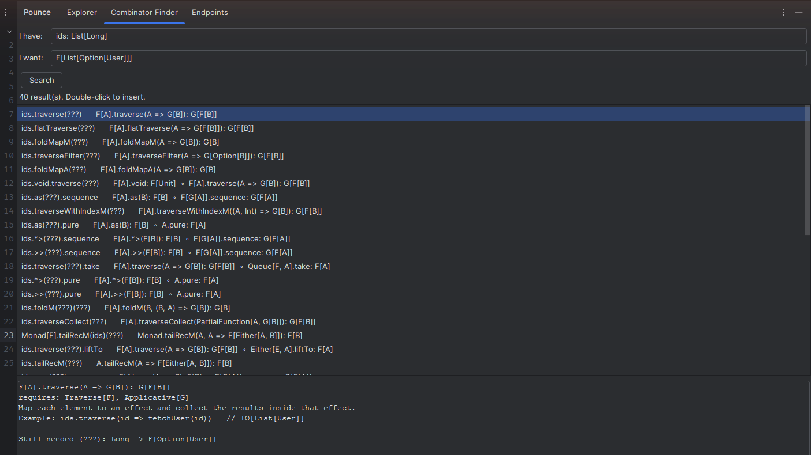
  <br>
  <sub>Combinator Finder: from <code>List[Long]</code> to <code>F[List[Option[User]]]</code>.</sub>
</p>

<details>
<summary>More screenshots: tagless wiring gutter, Typeclass Explorer, Endpoints</summary>
<br>
<p align="center">
  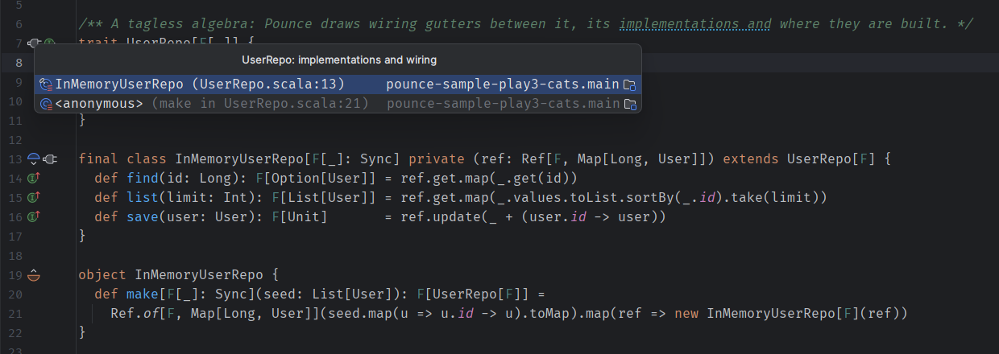
  <br>
  <sub>From a tagless algebra to its implementations and where they are built.</sub>
  <br><br>
  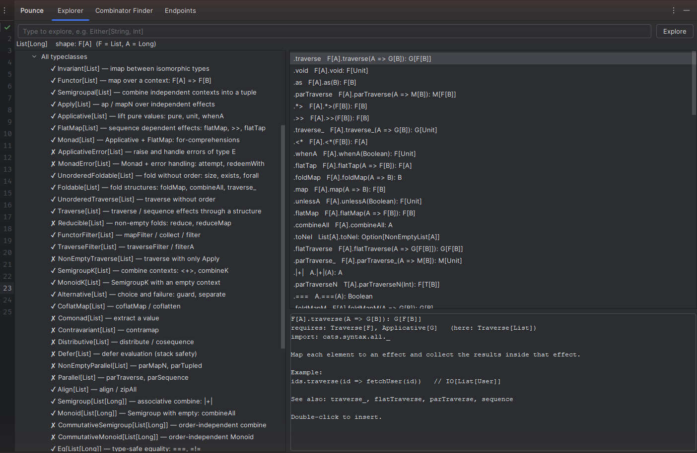
  <br>
  <sub>Typeclass Explorer: which instances <code>List[Long]</code> has, and what you can call on it.</sub>
  <br><br>
  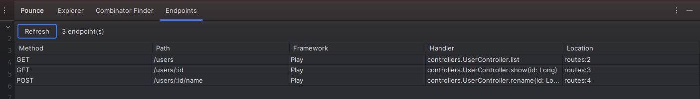
  <br>
  <sub>Endpoints: the sample's <code>conf/routes</code>, with navigation to each handler.</sub>
</p>
</details>

### Play 3 wiring, Spring-style
- **Config keys:**
  - completion in `config.get[Int]("…")`, Typesafe `Config` getters and pureconfig `.at("…")`, using your `application.conf`, its includes and every library `reference.conf`;
  - Ctrl+click to the defining line;
  - "Unknown config key" with an add-key fix;
  - find usages from the conf file.
- **Guice:**
  - gutters from `@Inject` parameters to their bindings and back; supported styles are `bind(classOf…)`, scala-guice `bind[A].to[B]`, `@Provides`, `@ImplementedBy` and Play `bind[A].to[B]`;
  - a conservative "Unbound injection" check.
- **i18n messages:** key completion and navigation, "Missing message key" and "Missing translation" with stub fixes.
- **IO ↔ Future bridge:** an intention that turns an `IO[Result]` action into `Action.async { io.unsafeToFuture() }`,
  using the runtime already in scope. Also live templates `ioaction`, `ioactionjson`, `guicebind`, `playmodule`.

<p align="center">
  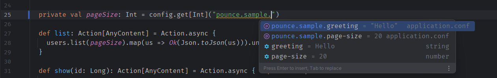
  <br>
  <sub>Config keys from your <code>application.conf</code>, with their values.</sub>
  <br><br>
  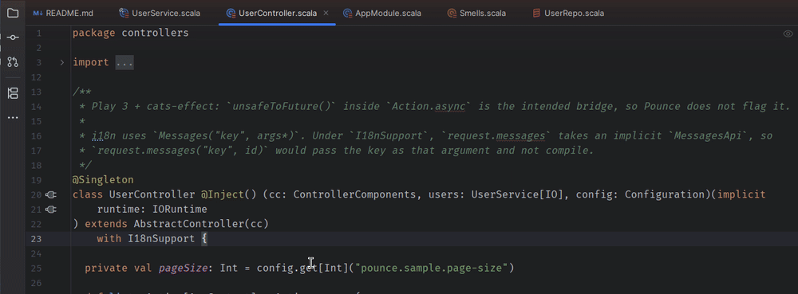
  <br>
  <sub>From an <code>@Inject</code> parameter to its <code>@Provides</code> binding, and back.</sub>
  <br><br>
  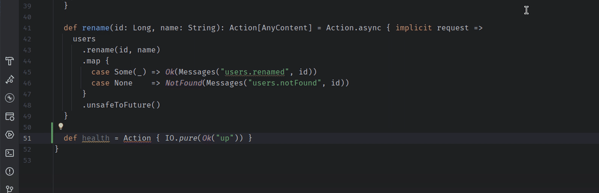
  <br>
  <sub>An <code>IO[Result]</code> action becomes <code>Action.async { … .unsafeToFuture() }</code>.</sub>
</p>

<details>
<summary>More screenshots: unknown config key, missing translation</summary>
<br>
<p align="center">
  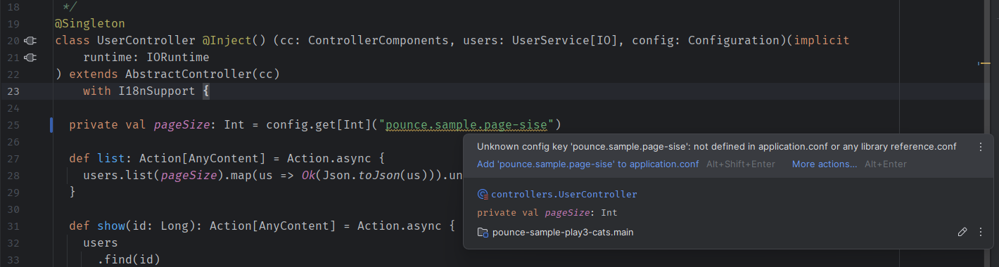
  <br>
  <sub>A typo in a config key, with a fix that adds it to <code>application.conf</code>.</sub>
  <br><br>
  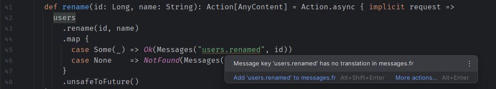
  <br>
  <sub>A message key without a French translation, with a stub fix.</sub>
</p>
</details>

### Runtime and tests
- **Debugger:** Step Into skips cats/cats-effect/fs2 internals. Renderers for `NonEmptyList`, `Chain`,
  `Validated`, `Ior`, `EitherT`, `OptionT` and `Ref`.
- **Fiber dump:** Tools → *Pounce: Dump Cats Effect Fibers* attaches to a running JVM and shows live fibers grouped by
  state, with clickable frames. It uses cats-effect's built-in JMX snapshot.
- **weaver:** run/debug gutters on suites and tests (munit-cats-effect already works through the Scala plugin).
- **Live templates:** `ioapp`, `ioappargs`, `resmake`, `algebra`, `ioref`, `weaversuite`, `munitce`.

Every feature can be toggled in **Settings → Languages & Frameworks → Pounce**.

---

## Install

1. Download `pounce-<version>.zip` from [Releases](https://github.com/zakariahere/pounce-intellij/releases).
2. In IntelliJ IDEA: **Settings → Plugins → ⚙ → Install Plugin from Disk…**, pick the zip, restart.

You need IntelliJ IDEA **2026.2** (build 262.9437 or newer) with the **Scala plugin** installed.

## Try it

`samples/play3-cats` is a small Play 3.0 + cats-effect app wired with Guice. Its `app/playground/Smells.scala` trips
the inspections on purpose. Open it in a sandbox IDE with Pounce installed:

```bash
sbt runIDE
```

Then open `samples/play3-cats` in the sandbox and follow `samples/play3-cats/README.md`.

## Build from source

Requirements: **JDK 25**, because IntelliJ 2026.2's jars are Java 25 class files. sbt 1.12 is also needed. The first build
downloads the IntelliJ SDK and the Scala plugin (a few GB) into `~/.pouncePluginIU`.

```bash
sbt packageArtifactZip        # target/pounce-<version>.zip → Settings → Plugins → ⚙ → Install from disk
sbt test                      # all suites (each boots a headless IDE)
sbt runPluginVerifier         # JetBrains Plugin Verifier against the target IDE
```

## How it works

```
core/         engine shared by every feature
  types/        Ty: an IntelliJ-independent type language + unification (partial unification for F[_])
  catalog/      600+ curated operations as HOCON data (signature, constraints, docs, examples)
  Typeclasses   the cats / cats-effect hierarchy as data
  InstanceOracle  "does TC have an instance for this type here?": bounds → static table → Scala plugin implicit search
  Applicability, Imports, Bounds, Effects, Libraries, settings
completion/   Pillar A: completion contributors, postfix templates, quick docs
inspections/  Pillars B + C: effect-safety inspections, simplifications, bound fixes
visual/       Pillar D: inlay hints, gutters, Pounce tool window (Explorer, Combinator Finder, Endpoints)
play/         Pillar E: config keys, Guice, i18n messages, IO bridge
runtime/      Pillar F: debugger stepping filters and renderers, fiber dump, weaver gutters, live templates
```

Each feature folder registers its extensions in its own `META-INF/pounce-<pillar>.xml`, which core's `plugin.xml`
includes. A root-level `PluginWiringTest` boots the fully merged plugin and checks that every class named in
those files loads. [PLAN.md](PLAN.md) has the product plan and design rationale.

## Known limitations
- **Only partly tried by hand.** In IntelliJ IDEA 2026.2.1, on a real Play 3 + cats project, these work: completion popups and
  quick docs, the inspections, config-key checks, Endpoints, for-comprehension hints and the Typeclass Explorer. Gutters,
  the Combinator Finder, the debugger renderers and the fiber dump console are covered by model tests only, not yet by hand.
- **Compiler-backed completion (Metals presentation compiler) is a no-go for v1.** See
  [runtime/docs/G1-compiler-backed-completion.md](runtime/docs/G1-compiler-backed-completion.md).
- **Config and messages files are handled as text,** not with a HOCON language plugin, so renaming a key doesn't update its usages.
- **Twirl `@messages(...)` isn't supported yet.**
- **Guice:** qualifiers (`@Named`) are ignored, and only Scala constructor injection is checked.
- **The http4s and tapir endpoint scanners are syntactic.**

## Contributing

Pull requests are welcome, especially catalog entries and simplification rules. See [CONTRIBUTING.md](CONTRIBUTING.md):
adding an operation to the catalog takes about five lines of HOCON.

## License

Apache License 2.0, see [LICENSE](LICENSE) and [NOTICE](NOTICE). The vendored test framework in
`scala-plugin-testkit/` comes from JetBrains' Scala plugin via [zio-intellij](https://github.com/zio/zio-intellij),
whose architecture also inspired parts of Pounce.
